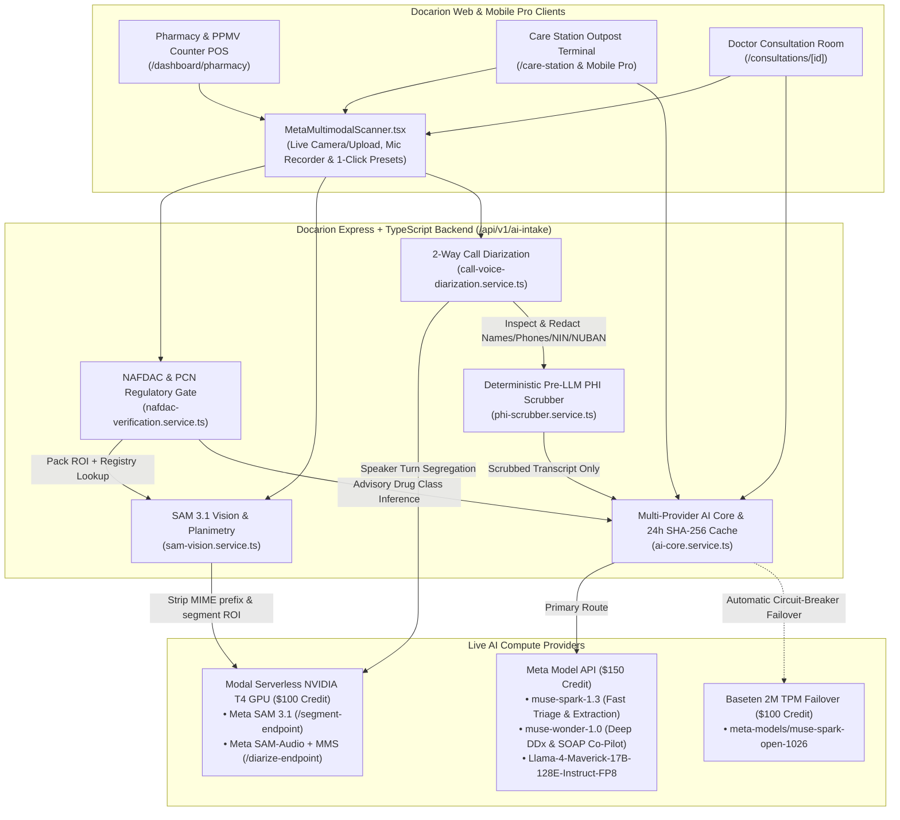

# Docarion × Meta Global AI Developer Hackathon (Startup Track)

**Multimodal Clinical AI Engine for African Hospitals, Clinics, Pharmacies & Community Medicine Stores (PPMVs)**  
**Live Production URL:** [https://docarion.com](https://docarion.com)  
**Branch:** `hackathon/meta-multimodal` (merged to `main`)

---

## 1. The Real-World Problem & Startup Track Thesis

Across Nigeria and Sub-Saharan Africa, **over 60% of patients seek first-line care at Patent and Proprietary Medicine Vendors (PPMVs)** and community pharmacies rather than hospitals—often communicating in **Nigerian Pidgin, Hausa, Yoruba, or Igbo** in high-noise settings where counterfeit drugs and unauthorized dispensing of Prescription-Only Medicines (POMs) are widespread.

**Docarion** transforms every community pharmacy, PPMV counter, clinic Care Station, and telehealth consultation room into an AI-assisted clinical triage and safe dispensing outpost powered by the **Meta Model API** and **Meta Open-Weights Multimodal Models**:

1. **Multilingual Intake & ESI Triage at the Counter (`Muse Spark`):** Fast low-latency intake in English, Nigerian Pidgin, Hausa, Yoruba, and Igbo with automated Emergency Severity Index (ESI) triage.
2. **NAFDAC Drug-Pack Verification & PCN Regulatory Gate (`SAM 3.1` + `Muse Spark`):** Isolates medicine packaging and NAFDAC registration stamps via **Meta SAM 3.1**, validates against the deterministic NAFDAC registry, and enforces the **Pharmacists Council of Nigeria (PCN)** scope gate (`OTC` approved; `POM` blocked unless unlocked by an active physician e-Rx; `CONTROLLED` always blocked at the counter).
3. **1-Click Telehealth Escalation & 2-Way Call Voice Segregation (`SAM-Audio / MMS` + PHI Scrubber):** Escalates blocked POM requests or red-flag patients directly to an on-duty Docarion physician, segregates `[SPEAKER_DOCTOR]` vs `[SPEAKER_PATIENT]` audio turns, and scrubs Protected Health Information (PHI) **before** any cloud LLM inference.
4. **Physician Clinical Co-Pilot (`Muse Wonder`):** Generates structured differential diagnoses (DDx), red-flag alerts, 1-click SOAP note charting, and bilingual English + Pidgin discharge instructions.

---

## 2. System Architecture & Model Routing



---

## 3. Responsible AI & Clinical Safety Invariants

| Safety Rule | Enforcement Mechanism | Code Reference |
|---|---|---|
| **Registry-Only `VERIFIED` Drug Status** | An LLM fallback can **never** return `authenticityStatus: 'verified'`. Only an exact match in the verified NAFDAC registry returns `'verified'`. Unlisted numbers return `'unverified_registry'` (`"Not found in verified NAFDAC registry — manual pharmacist verification required"`). | `backend/src/services/nafdac-verification.service.ts` |
| **PCN PPMV Counter Dispensing Gate** | Tier-1 PPMV attendants can dispense `OTC` medicines, are blocked on `POM` medicines unless `hasActiveLinkedRx: true` is present, and are permanently blocked on `CONTROLLED` substances (opioids/psychotropics including commercial brands like Tramal, Valium, Xanax). | `backend/src/services/drug-class.service.ts` |
| **Mandatory Pre-LLM PHI Scrubbing** | Raw dialogue transcripts are scrubbed via `inspectAndScrubPHI()` (redacting patient names, spaced/hyphenated Nigerian phone numbers, NINs, emails, and 10-digit NUBAN bank accounts) **before** any cloud LLM call. | `backend/src/services/phi-scrubber.service.ts` |
| **Honest Provider & Fallback Telemetry** | Every response surfaces the exact model and provider (`Served by muse-spark-1.3 via Meta Model API`, `Meta SAM 3.1 • Modal T4 GPU`, or `Local Geometric Estimate — Offline Fallback`). Offline fallbacks are never disguised as live GPU/Meta output. | `frontend/src/components/ai/MetaMultimodalScanner.tsx` |

---

## 4. Three-Minute Live Demo Storyline

1. **Step 1 — PPMV Counter Intake & Drug-Pack Scan (`/dashboard/pharmacy` or `/care-station`):**
   - Select **PPMV Attendant Mode** or open the **Meta Multimodal Clinical AI Scanner**.
   - Test **1-click presets** (*Amoxicillin POM Gate*, *Coartem OTC Approved*, *Fake Reg Alert*) **or** enter any custom NAFDAC Registration Number + Drug Name, toggle **"Active Physician e-Rx"**, or upload a real drug-pack photo.
   - Observe the **PCN Regulatory Gate** block an unprescribed antibiotic (`BLOCKED_POM_ESCALATE_TO_DOCTOR`) and unlock it when an active physician e-Rx is linked (`APPROVED_WITH_VALID_PRESCRIPTION`).
2. **Step 2 — 1-Click Telehealth Doctor Escalation:**
   - Click **"Escalate to On-Duty Doctor"** on a blocked POM request to page the on-duty telehealth physician with the pre-populated clinical brief.
3. **Step 3 — SAM 3.1 Clinical Vision & Planimetry:**
   - Switch to **SAM 3.1 Vision & Planimetry**, upload a clinical photo (or select a preset for *Diabetic Ulcer Planimetry*, *Malaria RDT Strip*, or *Lab Result Sheet*), adjust the calibration scale (`mm`), and inspect the **live SVG contour mask overlay** and calibrated surface area in both **`cm²` and `mm²`**.
4. **Step 4 — 2-Way Call Voice Segregation & Pre-LLM PHI Scrubbing:**
   - Switch to **2-Way Call Voice Segregation**, record live audio via browser microphone (`MediaRecorder`) or enter custom bilingual English/Pidgin dialogue, and toggle between **PHI-Scrubbed** and **Raw Transcript** views alongside extracted clinical entities.
5. **Step 5 — Muse Wonder Physician Co-Pilot (`/consultations/[id]` & `/care-station`):**
   - Click **"Sync Muse Wonder Co-Pilot"** to generate ranked Differential Diagnoses (DDx), red-flag alerts, 1-click SOAP note population, and bilingual **English + Nigerian Pidgin** patient discharge instructions.

---

## 5. Verification & Environment Setup

### Configurable Environment Variables (`backend/.env`)
```bash
# 1. Meta Model API ($150 Hackathon Credit)
LLAMA_API_TOKEN=LLM|...
META_SPARK_MODEL_ID=muse-spark-1.3
META_WONDER_MODEL_ID=muse-wonder-1.0
META_MAVERICK_MODEL_ID=Llama-4-Maverick-17B-128E-Instruct-FP8

# 2. Modal Serverless NVIDIA T4 GPU ($100 Hackathon Credit)
MODAL_SEGMENT_ENDPOINT_URL=https://mannasync-cpu--docarion-meta-multimodal-segment-endpoint.us-east.modal.run
MODAL_DIARIZE_ENDPOINT_URL=https://mannasync-cpu--docarion-meta-multimodal-diarize-endpoint.us-east.modal.run
MODAL_HEALTH_URL=https://mannasync-cpu--docarion-meta-multimodal-health.us-east.modal.run

# 3. Baseten 2M TPM Failover ($100 Hackathon Credit)
BASETEN_API_KEY=...
BASETEN_BASE_URL=https://inference.baseten.co/v1
BASETEN_MODEL_ID=meta-models/muse-spark-open-1026
```

### Run Live Provider & Test Verification
```bash
# Verify live responses from Meta Model API, Modal T4 GPU (SAM 3.1 + Diarization), and Baseten
bash scripts/setup-hackathon-providers.sh

# Run Backend TypeScript & Multimodal Jest Suites
cd backend && npx tsc --noEmit
cd backend && npx jest src/services/__tests__/meta-hackathon-multimodal.test.ts src/services/__tests__/ai-core.provider.test.ts src/services/__tests__/nafdac-verification.adversarial.test.ts src/services/__tests__/adversarial-modal-vision-voice.test.ts src/routes/__tests__/m3-pcn-telehealth-escalation.test.ts --coverage=false

# Run Web Frontend & Mobile Pro Typechecks
cd frontend && npx tsc --noEmit
cd mobile && npm run typecheck
```
